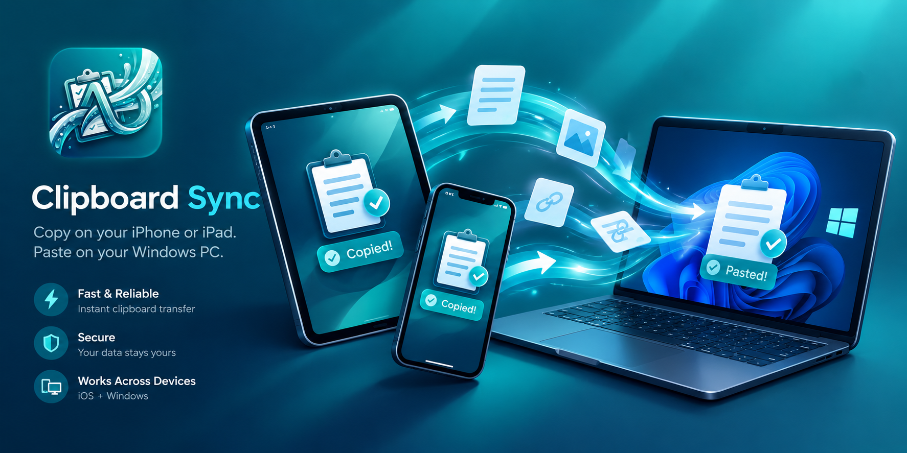
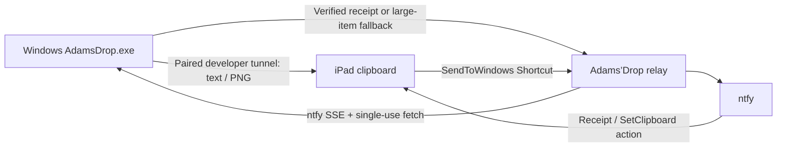

# Adams’Drop



**Current workflow:** Windows to iPad is automatic; iPad to Windows requires SendToWindows. iPhone compatibility is not yet verified.

**Copy on Windows. Paste on iPad.**

A Windows tray companion and small self-hosted relay for text, full-quality images and original iPad files, including videos, PDFs, CSVs and JSON. Direct transfers use a trusted Apple developer connection over Wi-Fi or USB; ntfy provides receipt notifications and a Shortcut fallback for large images and iPad files.

> Experimental integration with reverse-engineered Apple developer services. Automatic iPad-to-Windows capture is **not supported**. The iPad-to-Windows Shortcut is supported. This is not AirDrop or an Apple product.

## What you get

| Direction | Workflow |
| --- | --- |
| Windows → iPad | Copy normally, then paste on iPad; no app switch for verified direct transfers |
| Windows file → iPad (PDF, images, videos, JSON/TXT/CSV, archives, any extension) | Stream Deck button with files selected in the active Explorer tab, or right-click → Send to → AdamsDrop - iPad; tap the ntfy notification to save the original file and preview supported formats |
| Large Windows image → iPad | Lossless optimization first; if still over the direct cap, tap the ntfy notification to run SetClipboard |
| iPad → Windows | Run SendToWindows; text/images copy to the clipboard, and image notifications reveal the saved image in its folder |
| iPad video → Windows | Share with SendToWindows; the original file saves in Downloads/AdamsDrop and automatically reveals its folder when full-screen protection is off |
| iPad PDF/CSV/JSON/other file → Windows | Share with SendToWindows; the original file saves in Downloads/AdamsDrop, and its notification reveals its folder when clicked |

- Runs as **AdamsDrop.exe** with an **Adams’Drop** tray menu and optional login-only task.
- A **Stream Deck System → Open** action can launch **AdamsDropSend.exe** to send selected Explorer files or choose files. Explicit file sends show a small progress panel.
- Uses same-network Wi-Fi discovery, with USB preferred when attached.
- Checks exact clipboard read-back before confirming delivery.
- Restores developer support after iPad reboot when available through the paired tunnel.
- Marks imported Windows clipboard items to prevent echoes.
- Drops automatic offline failures and superseded copies instead of replaying a clipboard history later.

## Requirements

Windows 11, Apple Devices, a supported Python installation for building, and an iPad with Developer Mode enabled and trusted USB + developer pairing. Tested on an iPad Pro 12.9-inch (6th generation), reported iPadOS 26.6.1, using pymobiledevice3 **11.9.2**. Other devices/OS versions need validation. No Mac or Xcode is required for the tested path.

A reachable ntfy server and Linux Docker host provide the relay/fallback. The devices must be reachable on the same network for direct Wi-Fi transfer. Internet access may be required to download/personalize developer support after an update or reboot.

## Get started

1. Deploy the relay using [server setup](docs/SERVER.md).
2. Build and configure the Windows client using [Windows setup](docs/WINDOWS.md).
3. Pair the iPad and create the two fallback Shortcuts using [iPad setup](docs/IPAD.md).
4. Test text and an image, then verify Wi-Fi with USB removed.

Copy the example configuration files locally and replace placeholders. Real config, credentials, logs, caches, pairing records, build output and binaries are ignored by Git. Never distribute a configured installation directory.

## Limits and behavior

- Direct cap: **1,000,000 encoded bytes** after lossless PNG optimization. No downscaling or JPEG conversion.
- Relay cap: **25 MiB** for text/images, **2 GiB** for raw iPad video/file uploads, ten-minute single-use fetch links. Files stream through temporary disk storage and save on Windows after a SHA-256 check, leaving the clipboard unchanged. See [shortcut upgrade](docs/IPAD.md#add-original-video-sharing-to-sendtowindows) and [file sharing](docs/IPAD.md#send-pdfs-csvs-json-and-other-files). Existing ntfy/APNs queues can still deliver delayed notifications; this is not a hard real-time delivery system.
- Automatic Windows copies made while unavailable are discarded. Copy again when connected. Manual sends and large-image fallback are transient delivery requests, not clipboard history synchronization.
- iPad-to-Windows uses live SSE with old events rejected; it is not automatic native-copy monitoring.
- After restart, launch AdamsDrop and unlock the iPad once. First-copy recovery can be slower; OS updates may require repairing trust or developer support.
- Full-screen protection skips new clipboard transfers during detected full-screen activity; copy again afterwards. Windowed games may not be detected.
- One paired iPad is selected. Multi-device routing is not implemented.

## Architecture



## Development and tests

Use Windows with the client requirements installed:

```powershell
python relay/test_windows_sender.py
python relay/test_direct_limits.py
python relay/test_clipboard_backlog.py
python relay/test_foreground_guard.py
python relay/test_video_receiver.py
python relay/test_file_receiver.py
python relay/test_outbound_files.py
```

Relay tests: install relay requirements, set a temporary API_KEY, then run `python relay/test_relay.py relay/server.py`, `python relay/test_video_transfer.py` and `python relay/test_file_transfer.py`. They mock ntfy and do not publish messages. `windows-client/test_direct_pipeline.py` and `windows-client/test_incoming_pipeline.py` are live synthetic tests: it overwrites both clipboards and may produce notifications.

See [operations](docs/OPERATIONS.md), [security](SECURITY.md), and [release checklist](docs/RELEASING.md). Licensed under [MIT](LICENSE). Dependencies retain their own licenses.
